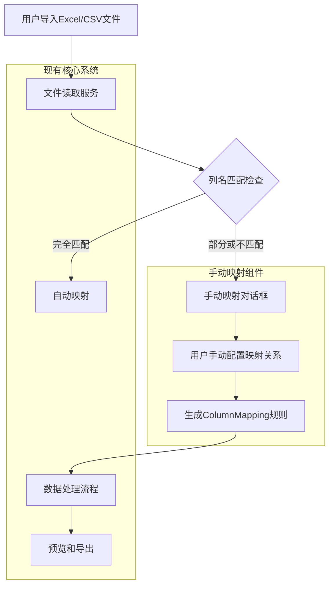
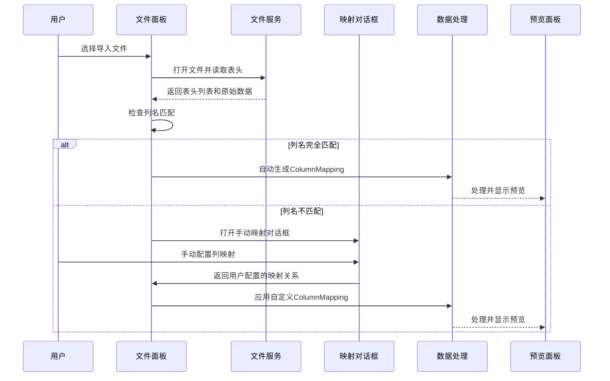

# Design Document: Manual Column Mapping

## Overview

为Excel Processor桌面应用程序添加手动列名映射功能。当用户导入Excel/CSV文件时，如果原始列名与系统预期的列名不匹配，系统将弹出对话框让用户手动建立映射关系。用户能够将源文件的列（如"A"、"B"、"C"）映射到目标列名（如"距坝理财"、"测量值"等），从而解决列名不完全匹配的问题，提高数据导入的灵活性和准确性。

## Architecture



## Sequence Diagrams

### 主流程：手动列名映射



## Components and Interfaces

### Component 1: Manual Mapping Dialog Component

**Purpose**: 提供用户界面，让用户手动配置源列到目标列的映射关系。支持自动建议、拖拽配对等功能。

**Interface**:
```typescript
interface ManualMappingDialogProps {
  /** 源文件的列名列表 */
  sourceHeaders: string[];
  /** 系统预期的目标列名列表（可配置） */
  targetHeaders: string[];
  /** 可选的预设映射关系 */
  presetMappings?: ColumnMapping[];
  /** 用户确认映射关系后的回调 */
  onConfirm: (mappings: ColumnMapping[]) => void;
  /** 取消操作的回调 */
  onCancel: () => void;
  /** 对话框是否可见 */
  visible: boolean;
}

interface ColumnMappingSuggestion {
  /** 源列名 */
  sourceHeader: string;
  /** 建议的目标列名 */
  suggestedTarget: string;
  /** 匹配置信度 (0-1) */
  confidence: number;
}
```

**Responsibilities**:
- 显示源列和目标列的并排列表
- 提供自动匹配建议算法（模糊匹配、子字符串匹配等）
- 支持用户拖拽或下拉选择进行列配对
- 验证映射关系的完整性（所有必需列是否都有映射）
- 提供预设映射模板的保存和加载功能

### Component 2: Enhanced FileService

**Purpose**: 扩展现有文件服务，增加列名匹配检查和手动映射触发逻辑。

**Interface**:
```typescript
interface EnhancedFileService {
  /**
   * 读取文件并检查列名匹配
   * @param filePath 文件路径
   * @param sheetName 工作表名称
   * @param expectedHeaders 期望的列名列表（可配置）
   * @returns 读取的数据和匹配状态
   */
  readSheetWithMatchCheck(
    filePath: string, 
    sheetName: string, 
    expectedHeaders?: string[]
  ): Promise<{
    data: SheetData;
    matchStatus: ColumnMatchStatus;
    suggestedMappings?: ColumnMappingSuggestion[];
  }>;

  /**
   * 获取或配置系统期望的列名
   */
  getExpectedHeaders(): string[];
  setExpectedHeaders(headers: string[]): void;
}

interface ColumnMatchStatus {
  /** 完全匹配的列数 */
  exactMatches: number;
  /** 模糊匹配的列数 */
  fuzzyMatches: number;
  /** 未匹配的列数 */
  unmatched: number;
  /** 是否需要手动映射 */
  needsManualMapping: boolean;
  /** 匹配度分数 (0-1) */
  matchScore: number;
}
```

### Component 3: Mapping Configuration Manager

**Purpose**: 管理列名映射的配置，包括预设模板、历史映射、自动匹配算法等。

**Interface**:
```typescript
interface MappingConfigManager {
  /** 预设映射模板 */
  mappingTemplates: MappingTemplate[];
  
  /** 保存用户配置的映射关系 */
  saveUserMapping(
    sourceHeaders: string[], 
    mappings: ColumnMapping[], 
    name?: string
  ): void;
  
  /** 加载历史映射配置 */
  loadUserMappings(): UserMappingHistory[];
  
  /** 自动建议映射算法 */
  suggestMappings(
    sourceHeaders: string[], 
    targetHeaders: string[]
  ): ColumnMappingSuggestion[];
  
  /** 验证映射完整性 */
  validateMappings(
    mappings: ColumnMapping[], 
    requiredColumns?: string[]
  ): ValidationResult;
}

interface MappingTemplate {
  id: string;
  name: string;
  description: string;
  sourcePatterns: string[]; // 源列名模式
  targetHeaders: string[];  // 对应的目标列名
}

interface UserMappingHistory {
  id: string;
  timestamp: Date;
  sourceFilePattern: string;
  mappings: ColumnMapping[];
  successRate: number; // 成功使用的次数
}
```

## Data Models

### Model 1: Enhanced ColumnMapping

```typescript
interface EnhancedColumnMapping {
  id: string;
  /** 源列名（从文件读取的原始列名） */
  sourceColumn: string;
  /** 输出列名（系统内部使用的规范列名） */
  outputName: string;
  /** 映射类型：自动、手动、预设 */
  mappingType: 'auto' | 'manual' | 'preset';
  /** 映射置信度（0-1，仅用于自动映射） */
  confidence?: number;
  /** 是否为必需列 */
  isRequired: boolean;
  /** 映射创建时间 */
  createdAt: Date;
  /** 公式（如果源列为空，表示计算列） */
  formula?: string;
  /** 输出顺序 */
  order: number;
}

interface ColumnMappingGroup {
  /** 映射分组ID */
  id: string;
  /** 分组名称（如："工程测量模板"） */
  name: string;
  /** 映射关系列表 */
  mappings: EnhancedColumnMapping[];
  /** 适用场景描述 */
  description: string;
  /** 最后使用时间 */
  lastUsed: Date;
}
```

### Model 2: Match Configuration

```typescript
interface MatchConfiguration {
  /** 自动匹配算法配置 */
  autoMatch: {
    /** 启用模糊匹配 */
    enableFuzzyMatch: boolean;
    /** 模糊匹配阈值（0-1） */
    fuzzyThreshold: number;
    /** 启用子字符串匹配 */
    enableSubstringMatch: boolean;
    /** 忽略的字符（如空格、下划线等） */
    ignoredChars: string[];
    /** 同义词映射表 */
    synonymMapping: Record<string, string[]>;
  };
  
  /** 手动映射配置 */
  manualMapping: {
    /** 是否显示自动建议 */
    showSuggestions: boolean;
    /** 建议数量限制 */
    suggestionLimit: number;
    /** 是否高亮必需列 */
    highlightRequiredColumns: boolean;
    /** 默认映射模板 */
    defaultTemplate?: string;
  };
  
  /** 预设模板配置 */
  templates: {
    /** 用户自定义模板存储路径 */
    userTemplatePath: string;
    /** 系统内置模板路径 */
    systemTemplatePath: string;
    /** 自动应用模板的条件 */
    autoApplyThreshold: number; // 匹配度达到此值时自动应用模板
  };
}
```

**Validation Rules**:
- 每个源列最多只能映射到一个目标列
- 必需列必须都有映射（除非明确跳过）
- 目标列名不能重复
- 公式列必须包含有效的列名引用格式

## Algorithmic Pseudocode

### 主算法：列名匹配检查和映射决策

```typescript
/**
 * 列名匹配检查和映射决策算法
 * @param sourceHeaders 源文件列名
 * @param targetHeaders 目标列名
 * @param config 匹配配置
 * @returns 匹配状态和建议映射
 */
function analyzeColumnMatching(
  sourceHeaders: string[],
  targetHeaders: string[],
  config: MatchConfiguration
): MatchAnalysisResult {
  // 1. 精确匹配检查
  const exactMatches = findExactMatches(sourceHeaders, targetHeaders);
  
  // 2. 模糊匹配建议（如果启用）
  let fuzzyMatches: ColumnMappingSuggestion[] = [];
  if (config.autoMatch.enableFuzzyMatch) {
    fuzzyMatches = findFuzzyMatches(
      sourceHeaders, 
      targetHeaders, 
      config.autoMatch.fuzzyThreshold
    );
  }
  
  // 3. 子字符串匹配建议（如果启用）
  let substringMatches: ColumnMappingSuggestion[] = [];
  if (config.autoMatch.enableSubstringMatch) {
    substringMatches = findSubstringMatches(sourceHeaders, targetHeaders);
  }
  
  // 4. 应用同义词映射
  const synonymAdjustedMatches = applySynonymMapping(
    [...exactMatches, ...fuzzyMatches, ...substringMatches],
    config.autoMatch.synonymMapping
  );
  
  // 5. 计算匹配度并决定是否需要手动映射
  const matchScore = calculateMatchScore(
    sourceHeaders.length,
    targetHeaders.length,
    synonymAdjustedMatches
  );
  
  const needsManualMapping = 
    matchScore < config.templates.autoApplyThreshold &&
    synonymAdjustedMatches.length < targetHeaders.length;
  
  // 6. 检查必需列是否都有映射
  const requiredColumns = getRequiredColumns(targetHeaders);
  const missingRequired = checkMissingRequiredColumns(
    requiredColumns,
    synonymAdjustedMatches
  );
  
  return {
    exactMatches,
    fuzzyMatches: synonymAdjustedMatches,
    matchScore,
    needsManualMapping: needsManualMapping || missingRequired.length > 0,
    missingRequiredColumns: missingRequired,
    suggestedMappings: generateSuggestedMappings(synonymAdjustedMatches)
  };
}

/**
 * 模糊匹配算法（基于编辑距离）
 */
function findFuzzyMatches(
  sourceHeaders: string[],
  targetHeaders: string[],
  threshold: number
): ColumnMappingSuggestion[] {
  const suggestions: ColumnMappingSuggestion[] = [];
  
  for (const source of sourceHeaders) {
    const normalizedSource = normalizeHeader(source);
    let bestMatch: { target: string; distance: number } | null = null;
    
    for (const target of targetHeaders) {
      const normalizedTarget = normalizeHeader(target);
      const distance = calculateLevenshteinDistance(
        normalizedSource,
        normalizedTarget
      );
      const maxLength = Math.max(normalizedSource.length, normalizedTarget.length);
      const similarity = 1 - distance / maxLength;
      
      if (similarity >= threshold) {
        if (!bestMatch || similarity > (1 - bestMatch.distance / maxLength)) {
          bestMatch = { target, distance };
        }
      }
    }
    
    if (bestMatch) {
      const maxLength = Math.max(
        normalizedSource.length,
        normalizeHeader(bestMatch.target).length
      );
      const confidence = 1 - bestMatch.distance / maxLength;
      
      suggestions.push({
        sourceHeader: source,
        suggestedTarget: bestMatch.target,
        confidence
      });
    }
  }
  
  return suggestions;
}

/**
 * 标准化表头（去除空格、特殊字符，统一大小写等）
 */
function normalizeHeader(header: string): string {
  return header
    .trim()
    .toLowerCase()
    .replace(/[_\s\-]+/g, '') // 移除下划线、空格、连字符
    .replace(/[^\w]/g, ''); // 移除非单词字符
}
```

**Preconditions**:
- `sourceHeaders` 和 `targetHeaders` 都是非空字符串数组
- `threshold` 值在0到1之间
- `config` 参数包含所有必需的配置项

**Postconditions**:
- 返回的匹配分析包含准确的匹配状态信息
- 建议的映射关系不会重复（一个源列最多一个建议）
- 匹配度分数在0到1之间
- 必需列的缺失情况被正确识别

**Loop Invariants**:
- 在模糊匹配循环中，`bestMatch` 始终包含当前找到的最佳匹配
- 相似度计算始终基于标准化后的字符串

## Key Functions with Formal Specifications

### Function 1: openFileWithManualMapping()

```typescript
/**
 * 打开文件并处理列名映射
 * @param expectedHeaders 可选，系统期望的列名
 * @returns 处理后的数据和映射配置
 */
async function openFileWithManualMapping(
  expectedHeaders?: string[]
): Promise<{
  data: SheetData;
  mappings: EnhancedColumnMapping[];
  matchStatus: ColumnMatchStatus;
}> {
  // 1. 打开文件对话框
  const fileResult = await window.api.openFile();
  if (!fileResult) {
    throw new Error('用户取消了文件选择');
  }
  
  // 2. 读取第一个工作表
  const sheetData = await window.api.readSheet(fileResult.filePath, fileResult.sheets[0]);
  
  // 3. 检查列名匹配
  const expected = expectedHeaders || getDefaultExpectedHeaders();
  const analysis = analyzeColumnMatching(sheetData.headers, expected, getMatchConfig());
  
  let finalMappings: EnhancedColumnMapping[];
  
  if (analysis.needsManualMapping) {
    // 4. 需要手动映射：打开对话框
    const userMappings = await showManualMappingDialog({
      sourceHeaders: sheetData.headers,
      targetHeaders: expected,
      suggestedMappings: analysis.suggestedMappings,
      missingRequiredColumns: analysis.missingRequiredColumns
    });
    
    finalMappings = userMappings;
  } else {
    // 5. 自动映射：使用建议的映射关系
    finalMappings = convertSuggestionsToMappings(
      analysis.suggestedMappings,
      sheetData.headers,
      expected
    );
  }
  
  // 6. 验证映射完整性
  const validation = validateMappings(finalMappings, getRequiredColumns(expected));
  if (!validation.isValid) {
    throw new Error(`映射验证失败: ${validation.errors.join(', ')}`);
  }
  
  // 7. 可选：保存成功的映射作为模板
  if (analysis.needsManualMapping) {
    saveAsTemplate({
      sourceHeaders: sheetData.headers,
      mappings: finalMappings,
      name: `映射_${new Date().toISOString().slice(0, 10)}`
    });
  }
  
  return {
    data: sheetData,
    mappings: finalMappings,
    matchStatus: {
      exactMatches: analysis.exactMatches.length,
      fuzzyMatches: analysis.fuzzyMatches.length,
      unmatched: sheetData.headers.length - (analysis.exactMatches.length + analysis.fuzzyMatches.length),
      needsManualMapping: analysis.needsManualMapping,
      matchScore: analysis.matchScore
    }
  };
}
```

**Preconditions**:
- `window.api.openFile()` 和 `window.api.readSheet()` 方法可用
- `getDefaultExpectedHeaders()` 返回有效的列名数组
- `getMatchConfig()` 返回完整的匹配配置

**Postconditions**:
- 返回包含数据、映射关系和匹配状态的对象
- 如果用户取消操作，抛出适当错误
- 最终映射关系经过验证，确保必需列都有映射
- 手动配置的映射关系会被保存为模板供后续使用

### Function 2: showManualMappingDialog()

```typescript
/**
 * 显示手动映射对话框
 * @param props 对话��属性
 * @returns 用户配置的映射关系
 */
async function showManualMappingDialog(
  props: ManualMappingDialogProps
): Promise<EnhancedColumnMapping[]> {
  return new Promise((resolve, reject) => {
    // 创建并显示对话框组件
    const dialog = createManualMappingDialog({
      ...props,
      onConfirm: (mappings) => {
        cleanupDialog(dialog);
        resolve(mappings);
      },
      onCancel: () => {
        cleanupDialog(dialog);
        reject(new Error('用户取消了手动映射'));
      }
    });
    
    // 渲染对话框到DOM
    renderDialog(dialog);
  });
}
```

**Preconditions**:
- `props` 包含所有必需的对话框参数
- DOM中有一个合适的容器用于渲染对话框
- React渲染环境已初始化

**Postconditions**:
- 返回用户确认的映射关系数组
- 如果用户取消，Promise被拒绝并抛出错误
- 对话框被正确清理，不会留下内存泄漏

## Example Usage

```typescript
// 示例1：基本使用
async function processUserFile() {
  try {
    const result = await openFileWithManualMapping();
    
    console.log('匹配状态:', result.matchStatus);
    console.log('映射关系:', result.mappings);
    
    // 应用映射规则处理数据
    const processed = processSheet(result.data, {
      columnMappings: result.mappings,
      filters: [],
      curveRules: []
    });
    
    // 显示预览
    updatePreview(processed);
    
  } catch (error) {
    console.error('处理失败:', error);
    showErrorMessage(error.message);
  }
}

// 示例2：使用预设期望列名
const engineeringHeaders = [
  '距坝里程',
  '测量值', 
  '时间戳',
  '设备编号',
  '质量等级'
];

async function processEngineeringData() {
  const result = await openFileWithManualMapping(engineeringHeaders);
  
  if (result.matchStatus.matchScore > 0.8) {
    console.log('自动匹配成功，匹配度:', result.matchStatus.matchScore);
  } else {
    console.log('需要手动映射，匹配度:', result.matchStatus.matchScore);
  }
  
  return result;
}

// 示例3：批量处理多个文件
async function batchProcessFiles(filePaths: string[]) {
  const results = [];
  
  for (const filePath of filePaths) {
    // 读取文件
    const sheetData = await window.api.readSheet(filePath, 'Sheet1');
    
    // 检查是否已有匹配模板
    const template = findMatchingTemplate(sheetData.headers);
    
    let mappings: EnhancedColumnMapping[];
    if (template) {
      // 使用模板
      mappings = applyTemplate(sheetData.headers, template);
      console.log(`文件 ${filePath} 使用模板: ${template.name}`);
    } else {
      // 需要手动映射（对于批量处理，可以记录但不中断）
      console.warn(`文件 ${filePath} 需要手动映射，已跳过`);
      continue;
    }
    
    // 处理数据
    const processed = processSheet(sheetData, {
      columnMappings: mappings,
      filters: [],
      curveRules: []
    });
    
    results.push({ filePath, processed });
  }
  
  return results;
}
```

## Correctness Properties

### 映射完整性属性
```typescript
// 属性1：必需列必须都有映射
property('所有必需列都必须有映射', () => {
  const requiredColumns = ['距坝里程', '测量值', '时间戳'];
  const mappings = generateTestMappings();
  const validation = validateMappings(mappings, requiredColumns);
  
  return validation.isValid === 
    requiredColumns.every(req => 
      mappings.some(m => m.outputName === req && m.sourceColumn !== '')
    );
});

// 属性2：源列到目标列的映射是单射（一对一）
property('源列到目标列的映射是单射', () => {
  const mappings = generateTestMappings();
  const sourceColumns = mappings.map(m => m.sourceColumn).filter(c => c !== '');
  const uniqueSources = new Set(sourceColumns);
  
  return sourceColumns.length === uniqueSources.size;
});

// 属性3：目标列名不重复
property('目标列名不重复', () => {
  const mappings = generateTestMappings();
  const outputNames = mappings.map(m => m.outputName);
  const uniqueOutputs = new Set(outputNames);
  
  return outputNames.length === uniqueOutputs.size;
});

// 属性4：自动匹配的置信度在0到1之间
property('自动匹配置信度在有效范围内', () => {
  const suggestions = generateTestSuggestions();
  
  return suggestions.every(s => 
    s.confidence >= 0 && s.confidence <= 1
  );
});

// 属性5：匹配度分数在0到1之间
property('匹配度分数在有效范围内', () => {
  const sourceHeaders = ['A', 'B', 'C'];
  const targetHeaders = ['X', 'Y', 'Z'];
  const analysis = analyzeColumnMatching(sourceHeaders, targetHeaders, defaultConfig);
  
  return analysis.matchScore >= 0 && analysis.matchScore <= 1;
});
```

## Error Handling

### Error Scenario 1: 无匹配列名

**Condition**: 源文件列名与目标列名没有任何匹配（匹配度为0）

**Response**: 
- 显示高优先级警告
- 自动打开手动映射对话框
- 提供"跳过此文件"或"继续映射"选项
- 记录到错误日志

**Recovery**:
- 用户可以手动配置所有映射
- 或选择跳过文件继续处理其他文件
- 系统可以保存此配置作为新模板

### Error Scenario 2: 必需列缺失映射

**Condition**: 必需的目标列（如"距坝里程"）没有对应的源列映射

**Response**:
- 在手动映射对话框中高亮显示缺失的必需列
- 阻止用户确认直到所有必需列都有映射
- 提供"标记为可选"或"跳过此列"选项（需确认）

**Recovery**:
- 用户必须为每个必需列指定映射（或明确跳过）
- 系统验证完整性后才允许继续

### Error Scenario 3: 映射冲突

**Condition**: 同一个源列被映射到多个目标列，或多个源列映射到同一个目标列

**Response**:
- 立即检测并高亮显示冲突
- 提供自动解决建议（基于置信度选择最佳映射）
- 阻止保存直到冲突解决

**Recovery**:
- 用户手动解决冲突
- 或接受系统的自动建议
- 系统记录冲突解决方式

### Error Scenario 4: 模板应用失败

**Condition**: 尝试应用预设模板但源列名与模板模式不匹配

**Response**:
- 显示模板匹配失败警告
- 提供"编辑模板"或"重新匹配"选项
- 退回手动映射模式

**Recovery**:
- 用户可以编辑模板以适应新文件格式
- 或创建新的映射配置
- 系统可以学习新的列名模式

## Testing Strategy

### Unit Testing Approach

**测试重点**:
1. 列名匹配算法（精确匹配、模糊匹配、子字符串匹配）
2. 映射验证逻辑
3. 模板应用和保存
4. 对话框状态管理

**测试用例示例**:
```typescript
describe('列名匹配算法', () => {
  test('精确匹配应正确识别', () => {
    const source = ['距坝里程', '测量值'];
    const target = ['距坝里程', '测量值'];
    const result = analyzeColumnMatching(source, target, config);
    expect(result.exactMatches).toHaveLength(2);
    expect(result.matchScore).toBe(1);
  });
  
  test('模糊匹配应计算正确置信度', () => {
    const source = ['距坝里程1'];
    const target = ['距坝里程'];
    const result = analyzeColumnMatching(source, target, config);
    expect(result.fuzzyMatches[0].confidence).toBeGreaterThan(0.8);
  });
  
  test('必需列缺失应触发手动映射', () => {
    const source = ['A', 'B'];
    const target = ['距坝里程', '测量值']; // 必需列
    const result = analyzeColumnMatching(source, target, config);
    expect(result.needsManualMapping).toBe(true);
    expect(result.missingRequiredColumns).toContain('距坝里程');
  });
});
```

**覆盖率目标**:
- 业务逻辑覆盖率 > 90%
- 错误处理路径覆盖率 > 85%
- 用户交互组件覆盖率 > 80%

### Property-Based Testing Approach

**Property-Based Testing Strategy**:
使用fast-check进行基于属性的测试，验证映射算法的数学属性。

**Property Test Library**: fast-check

**关键属性测试**:
```typescript
import * as fc from 'fast-check';

describe('映射算法属性测试', () => {
  test('映射验证的单调性', () => {
    fc.assert(
      fc.property(
        fc.array(fc.string({ minLength: 1 })),
        fc.array(fc.string({ minLength: 1 })),
        (sourceHeaders, targetHeaders) => {
          const result1 = analyzeColumnMatching(sourceHeaders, targetHeaders, config);
          // 添加更多匹配应提高匹配度
          const extendedTarget = [...targetHeaders, ...sourceHeaders];
          const result2 = analyzeColumnMatching(sourceHeaders, extendedTarget, config);
          
          return result2.matchScore >= result1.matchScore;
        }
      )
    );
  });
  
  test('映射完整性验证', () => {
    fc.assert(
      fc.property(
        fc.array(fc.record({
          sourceColumn: fc.string({ minLength: 1 }),
          outputName: fc.string({ minLength: 1 }),
          mappingType: fc.constantFrom('auto', 'manual', 'preset')
        })),
        fc.array(fc.string({ minLength: 1 })),
        (mappings, requiredColumns) => {
          const validation = validateMappings(mappings, requiredColumns);
          // 如果验证通过，所有必需列都有映射
          if (validation.isValid) {
            return requiredColumns.every(req => 
              mappings.some(m => m.outputName === req)
            );
          }
          return true; // 验证失败的情况由其他测试覆盖
        }
      )
    );
  });
});
```

### Integration Testing Approach

**集成测试策略**:
1. 端到端文件处理流程
2. 对话框打开和关闭状态管理
3. IPC通信正确性
4. 模板持久化存储

**测试场景**:
- 用户选择文件 → 自动匹配成功 → 预览显示
- 用户选择文件 → 需要手动映射 → 配置后预览显示
- 批量处理多个文件 → 部分成功部分需要手动映射
- 模板保存和加载功能

## Performance Considerations

### 性能要求
1. **列名匹配算法**: 对于包含100个列的文件，匹配计算应在100ms内完成
2. **对话框渲染**: 对话框打开时间应小于200ms
3. **模板搜索**: 从100个模板中搜索匹配应在50ms内完成

### 优化策略
1. **缓存匹配结果**: 对相同文件格式缓存匹配结果，避免重复计算
2. **延迟加载**: 对话框组件按需加载，减少初始包大小
3. **虚拟滚动**: 对于大量列（>50），使用虚拟滚动优化渲染性能
4. **算法优化**: 使用Trie树优化字符串匹配，使用Web Worker进行耗时计算

### 内存管理
1. **对话框状态**: 对话框关闭时立即清理状态和DOM元素
2. **模板缓存**: 实现LRU缓存，限制缓存的模板数量
3. **大数据文件**: 对于超大文件（>10MB），使用流式处理或分页加载

## Security Considerations

### 输入验证
1. **列名安全**: 验证列名不包含恶意脚本或特殊字符
2. **公式安全**: 继续使用现有的公式安全验证机制
3. **文件路径**: 验证文件路径，防止目录遍历攻击

### 数据隐私
1. **模板存储**: 用户创建的模板存储在用户本地，不上传服务器
2. **列名信息**: 列名作为元数据，不包含敏感业务数据
3. **错误信息**: 错误信息不暴露系统内部路径或结构

### 用户控制
1. **明确同意**: 自动应用模板前需要用户确认（可配置阈值）
2. **撤销操作**: 提供完善的撤销/重做功能
3. **操作日志**: 记录重要的映射操作，支持审计

## Dependencies

### 新增依赖
1. **字符串匹配库**: 可选，用于改进模糊匹配算法（如`fuse.js`）
2. **本地存储**: 使用Electron的`localStorage`或`electron-store`保存模板
3. **UI组件库**: 可考虑使用现有组件库的对话框、拖拽组件

### 现有依赖扩展
1. **xlsx库**: 已使用，无需变更
2. **exceljs库**: 已使用，无需变更
3. **React状态管理**: 使用现有状态管理模式，扩展`App.tsx`状态

### 兼容性考虑
1. **向后兼容**: 新功能不影响现有列映射功能
2. **配置迁移**: 现有用户的映射配置自动迁移到新格式
3. **错误降级**: 如果新功能出错，回退到原有严格匹配模式